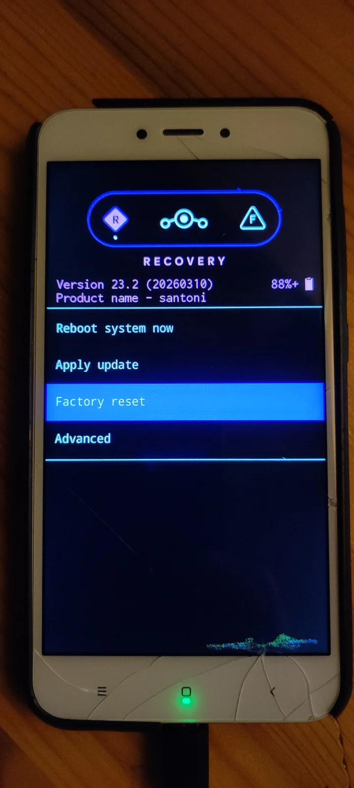
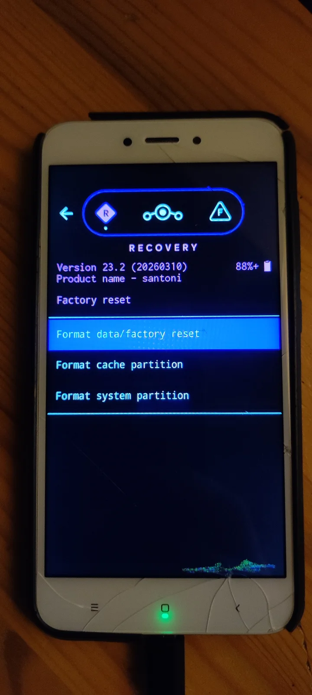
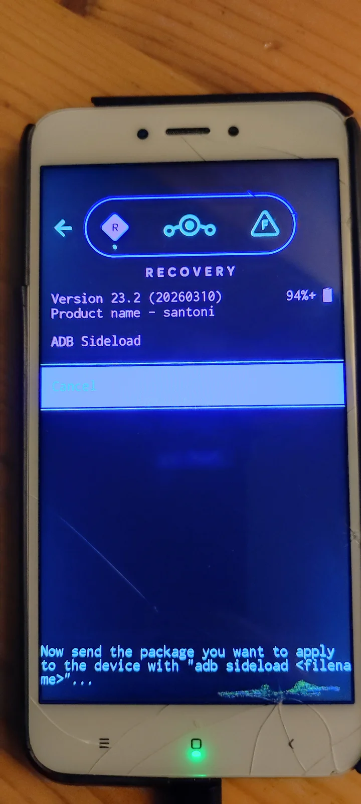
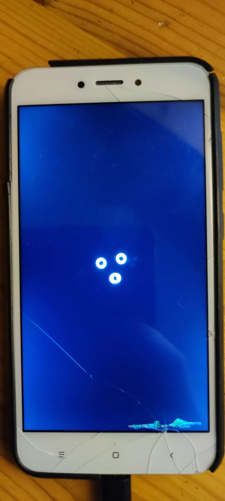

[LineageOS](https://lineageos.org/) to otwarty system Android rozwijany przez społeczność. Daje możliwość dłuższego korzystania ze starszego telefonu, ograniczenia zbędnych aplikacji producenta oraz większej kontroli nad systemem. Instalacja nie jest jednak uniwersalna: dokładne kroki, pliki i komendy zależą od konkretnego modelu urządzenia.

W tym poradniku pokazuję bezpieczny schemat pracy. Najważniejsza zasada brzmi: korzystam wyłącznie z instrukcji dla swojego urządzenia dostępnej w [oficjalnej wiki LineageOS](https://wiki.lineageos.org/devices/) i nie zastępuję jej poradnikiem przygotowanym dla podobnego modelu.

# Zanim zacznę

Instalacja alternatywnego systemu zwykle wymaga odblokowania bootloadera. To operacja, która:

* usuwa dane z telefonu,
* może wyłączyć część funkcji producenta,
* może wpłynąć na gwarancję lub obsługę płatności zbliżeniowych,
* wiąże się z ryzykiem utraty danych albo unieruchomienia telefonu przy użyciu niewłaściwych plików.

Dlatego wykonuję pełną kopię zdjęć, dokumentów, kodów uwierzytelniania i danych aplikacji. Warto też upewnić się, że znamy hasło do konta Google używanego na urządzeniu — po resecie może zadziałać ochrona Factory Reset Protection.

Potrzebuję również:

* telefonu obsługiwanego przez LineageOS,
* przewodu USB umożliwiającego transmisję danych,
* komputera z aktualnym `adb` i `fastboot`,
* naładowanej baterii,
* plików pobranych wyłącznie z oficjalnej strony projektu lub wskazanych w instrukcji urządzenia.

# Sprawdzam dokładny model

Nazwy handlowe telefonów bywają mylące. Ten sam model sprzedawany w różnych regionach może mieć inny procesor, inną partycję systemową albo inny kod urządzenia. Obraz przeznaczony dla niewłaściwej wersji nie zadziała, a w najgorszym przypadku może uniemożliwić uruchomienie telefonu.

Na stronie urządzeń LineageOS wyszukuję konkretny model i przechodzę do jego instrukcji instalacji. Zanim pobiorę jakikolwiek plik, sprawdzam:

1. kod urządzenia,
2. wymaganą wersję oryginalnego oprogramowania lub firmware,
3. sposób odblokowania bootloadera,
4. wymagany obraz recovery,
5. dodatkowe kroki dla konkretnego producenta.

Dla Xiaomi Redmi 4(X) pierwotny kod urządzenia to `santoni`; szczegóły znajdują się na [oficjalnej stronie urządzenia](https://wiki.lineageos.org/devices/santoni/).

## Mi8937

Od LineageOS 19.1 wsparcie dla Redmi 4(X) zostało przeniesione z nazwy `santoni` do `Mi8937`. Dlatego przed pobraniem obrazu, recovery lub instrukcji instalacji sprawdzam także [stronę urządzenia Mi8937](https://wiki.lineageos.org/devices/Mi8937/). Używam plików wyłącznie wtedy, gdy dokumentacja Mi8937 wyraźnie wskazuje zgodność z posiadaną wersją Redmi 4(X).

# Przygotowanie ADB i Fastboot

ADB pozwala komunikować się z uruchomionym Androidem lub recovery, a Fastboot służy do pracy z bootloaderem. Najwygodniej korzystać z oficjalnych Android SDK Platform Tools.

Aktualne archiwa dla [Windows, macOS i Linuxa](https://developer.android.com/tools/releases/platform-tools) pobieram bezpośrednio ze strony Android Developers. Zawierają oba potrzebne programy: `adb` i `fastboot`.

## Linux

Po pobraniu archiwum dla Linuxa rozpakowuję je w katalogu domowym i przechodzę do utworzonego katalogu `platform-tools`:

```
mkdir -p ~/Android
unzip platform-tools-latest-linux.zip -d ~/Android
cd ~/Android/platform-tools
./adb version
./fastboot --version
```

Polecenia mogę następnie uruchamiać z tego katalogu z prefiksem `./` albo dodać `~/Android/platform-tools` do zmiennej `PATH`.

W Debianie i Ubuntu mogę też zainstalować narzędzia z repozytorium systemowego:

```
sudo apt update
sudo apt install --yes adb fastboot android-udev-rules
adb version
fastboot --version
```

Pakiet `android-udev-rules` pozwala używać telefonu przez USB bez uruchamiania `adb` i `fastboot` jako root. Wersja z APT może być starsza od aktualnych Platform Tools Google, dlatego przed instalacją systemu warto porównać wersję; w razie wątpliwości wybieram oficjalne archiwum.

## Windows

Dla Windows pobieram archiwum Platform Tools, rozpakowuję je na przykład do `C:\Android\platform-tools` i uruchamiam w tym katalogu PowerShell:

```
.\adb.exe version
.\fastboot.exe --version
```

Mogę później dodać katalog `platform-tools` do `PATH`, aby wywoływać programy z dowolnego katalogu.

Po instalacji podłączam telefon przewodem USB, włączam w nim opcje programistyczne i debugowanie USB, a następnie sprawdzam połączenie:

```
adb devices
```

Na ekranie telefonu potwierdzam odcisk klucza komputera. W odpowiedzi pojawia się numer seryjny urządzenia oraz status `device`:

```
List of devices attached
<numer-seryjny>    device
```

Gdy urządzenie jest poprawnie wykryte, mogę uruchomić je ponownie do trybu bootloadera:

```
adb -d reboot bootloader
```

Dostępność w trybie Fastboot sprawdzam poleceniem. Poprawna odpowiedź zawiera ten sam numer seryjny i status `fastboot`:

```
fastboot devices

<numer-seryjny>    fastboot
```

Jeżeli telefon nie pojawia się na liście, warto zmienić przewód lub port USB. W systemie Linux może być też konieczne dodanie odpowiednich reguł `udev`.

# Odblokowanie bootloadera

Ten etap wygląda inaczej dla każdego producenta. W niektórych urządzeniach wystarcza aktywowanie opcji „OEM unlocking” i komenda Fastboot, inne wymagają wcześniejszego powiązania konta producenta albo uzyskania kodu odblokowującego.

W przypadku urządzeń Xiaomi zaczynam od oficjalnego narzędzia [Mi Unlock](https://en.miui.com/unlock/download_en.html). Działa ono w systemie Windows i wymaga zalogowania tym samym kontem Xiaomi, które jest powiązane z telefonem. Przed użyciem włączam opcje programistyczne, otwieram **Mi Unlock status** i wiążę konto z urządzeniem. Xiaomi może również wymagać okresu oczekiwania przed odblokowaniem.

Alternatywą dla osób pracujących poza Windowsem jest społecznościowy [MiUnlockTool](https://github.com/MiForge/MiUnlockTool). Narzędzie działa na różnych systemach operacyjnych i pomaga uzyskać `encryptData(token)` potrzebny w procesie odblokowania bootloadera. Nie jest to narzędzie producenta, dlatego przed użyciem sprawdzam jego dokumentację, pobieram je wyłącznie z oficjalnego repozytorium projektu i nadal stosuję wymagania Xiaomi dotyczące powiązania konta oraz okresu oczekiwania.

Nie kopiuję komend z przypadkowych poradników. Wykonuję dokładnie polecenie z oficjalnej instrukcji dla danego urządzenia. Telefon zazwyczaj wyświetli ostrzeżenie, a potwierdzenie odblokowania usuwa wszystkie dane.

Po ponownym uruchomieniu konfiguruję Androida tylko w minimalnym zakresie: włączam ponownie opcje programistyczne i debugowanie USB, jeśli są potrzebne w dalszej części procedury.

# Instalacja recovery

LineageOS udostępnia dla obsługiwanych urządzeń własne recovery albo wymaga konkretnego obrazu instalacyjnego. To właśnie z poziomu recovery instaluję system przez `adb sideload`.

Sposób uruchomienia recovery bywa różny. W zależności od modelu obraz może być tymczasowo uruchamiany, flashowany do partycji `boot`, `vendor_boot` lub innej wskazanej w instrukcji. To kolejny powód, by nie zgadywać parametrów Fastboot.

Jeżeli instrukcja dla urządzenia wskazuje partycję `recovery`, obraz wgrywam z poziomu Fastboot:

```
fastboot flash recovery recovery.img
```

Po poprawnym wykonaniu polecenia Fastboot potwierdza wysłanie i zapis obrazu:

```
Sending 'recovery' (...)                          OKAY
Writing 'recovery'                                OKAY
Finished. Total time: ...
```

Nazwa partycji i pliku są tylko przykładem. Dla Redmi 4(X) używam wyłącznie recovery oraz komendy wskazanych w dokumentacji LineageOS dla odpowiedniego kodu urządzenia.

Jeżeli instrukcja wymaga jedynie tymczasowego uruchomienia pobranego recovery, bez zapisywania go na partycji, używam:

```
fastboot boot recovery.img
```

Pomyślne uruchomienie obrazu Fastboot potwierdza następującymi komunikatami:

```
Sending 'boot.img' (...)                          OKAY
Booting                                            OKAY
Finished. Total time: ...
```

Po uruchomieniu recovery wybieram opcję formatowania danych, jeśli wymaga tego dokumentacja. Czyszczenie danych jest konieczne przy przejściu z fabrycznego systemu na LineageOS.



*Menu Lineage Recovery: przed wyborem resetu danych warto jeszcze raz upewnić się, że używany jest właściwy obraz dla telefonu.*



*Formatowanie danych usuwa zawartość telefonu — wykonuję je tylko wtedy, gdy wymaga tego instrukcja dla urządzenia i mam kopię zapasową.*

# Wgranie systemu

Oficjalny plik instalacyjny pobieram ze strony LineageOS dla właściwego kodu urządzenia. Przed instalacją sprawdzam sumę kontrolną lub podpis, gdy projekt udostępnia taką możliwość.

W recovery wybieram tryb **Apply update** / **Apply from ADB**, a na komputerze uruchamiam:

```
adb sideload nazwa-pliku-lineageos.zip
```



*Tryb ADB Sideload oczekuje na polecenie `adb sideload` uruchomione na komputerze.*

Warto pamiętać, że pasek postępu po stronie komputera może zatrzymać się przed 100%. To typowe dla `adb sideload`; o powodzeniu decyduje komunikat widoczny w recovery.

Po zakończeniu instalacji restartuję telefon do systemu. Pierwsze uruchomienie może potrwać kilka minut.



*Pierwszy start świeżo zainstalowanego systemu może trwać wyraźnie dłużej niż zwykłe uruchomienie telefonu.*

# Usługi Google i dodatkowe aplikacje

LineageOS nie zawiera domyślnie usług Google. To świadoma decyzja projektu, która pozwala użytkownikowi wybrać poziom integracji z ekosystemem Google.

Jeżeli potrzebuję Sklepu Play i usług Google, instaluję zgodny pakiet dodatków bezpośrednio po wgraniu LineageOS — przed pierwszym pełnym uruchomieniem systemu, jeżeli tak stanowi instrukcja wybranego pakietu. Pakiet musi odpowiadać:

* wersji Androida w instalowanym LineageOS,
* architekturze procesora urządzenia,
* procedurze instalacji wskazanej dla danego modelu.

Alternatywą są aplikacje z F-Droida, Aurora Store lub rozwiązania wykorzystujące microG. Wybór zależy od tego, czy ważniejsze są prywatność, dostęp do konkretnej aplikacji, czy zgodność z usługami Google.

# Pierwsze kroki po instalacji

Po uruchomieniu nowego systemu aktualizuję go w ustawieniach LineageOS i przywracam tylko potrzebne dane. Nie instaluję od razu wielu modyfikacji — najpierw sprawdzam działanie połączeń, Wi‑Fi, aparatu, Bluetootha, NFC oraz ładowania.

Dobrą praktyką jest także:

* ustawienie blokady ekranu i kopii zapasowej,
* zapisanie kodów odzyskiwania do kont,
* regularne instalowanie aktualizacji systemu,
* zachowanie pobranych plików i linku do instrukcji urządzenia,
* unikanie roota, jeśli nie jest rzeczywiście potrzebny.

# Podsumowanie

LineageOS może dać drugie życie telefonowi i pozwala korzystać z Androida na własnych zasadach. Największym błędem jest jednak traktowanie instalacji jako identycznej dla wszystkich modeli. Bezpieczna procedura zawsze zaczyna się od identyfikacji urządzenia, kopii danych i oficjalnej instrukcji dla jego kodu.

Jeśli zachowamy ostrożność, użyjemy właściwych plików i nie pominiemy wymaganych kroków, instalacja LineageOS jest przewidywalnym procesem — a nie eksperymentem wykonywanym na ślepo.
